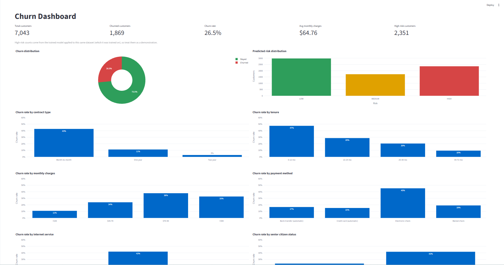
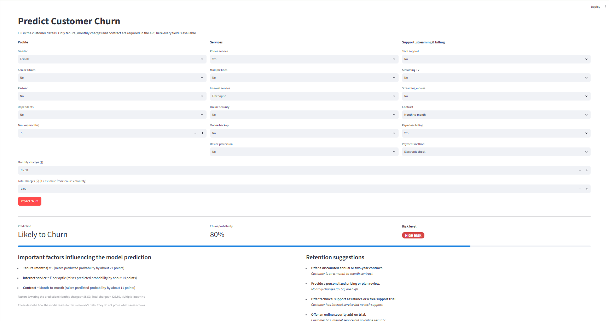
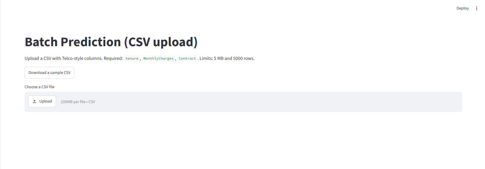
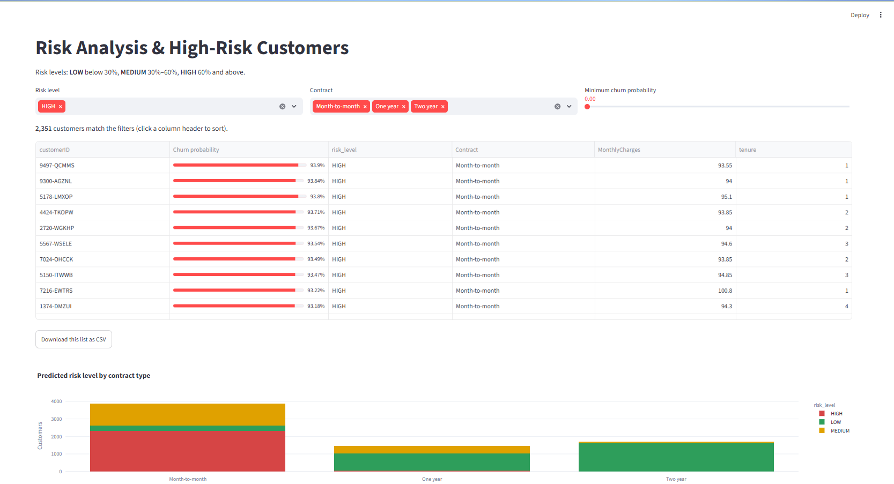
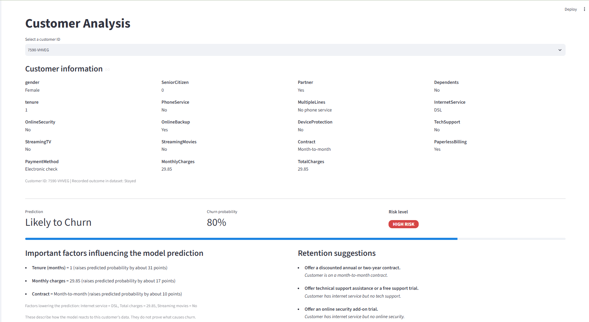
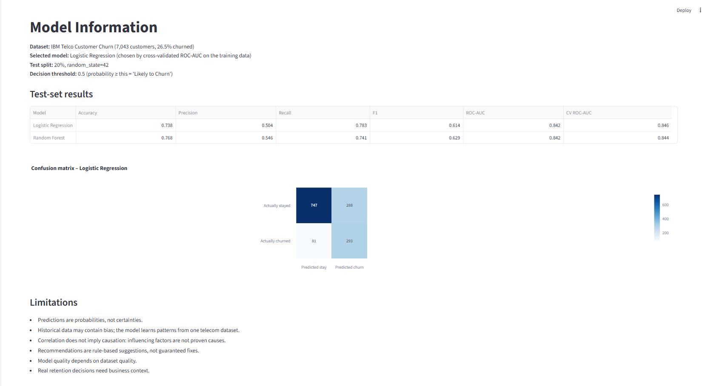

# Customer Churn Prediction, Risk Analysis & Retention Recommendation System

An end-to-end Machine Learning project that predicts telecom customer churn, estimates customer risk, explains factors influencing predictions, and recommends retention actions through an interactive Streamlit dashboard and a FastAPI REST API.

## Overview

Customer churn occurs when a customer stops using a company's services. Identifying customers who may leave helps businesses make better retention decisions.

This project uses customer data to estimate churn probability, categorize customers into risk levels, identify influential factors, and suggest possible retention strategies.

### Key Features

- **Churn Prediction:** Predict the probability that a customer will leave.
- **Risk Classification:** Categorize customers as Low, Medium, or High risk.
- **Prediction Explanations:** Identify factors influencing individual predictions.
- **Retention Recommendations:** Generate rule-based suggestions for at-risk customers.
- **Interactive Dashboard:** Explore churn patterns and business KPIs.
- **High-Risk Customer Analysis:** Filter, sort, and export high-risk customers.
- **Batch Predictions:** Upload CSV files and download prediction results.
- **REST API:** Access model predictions using FastAPI.
- **Model Evaluation:** Compare ML models using multiple evaluation metrics.
- **Automated Tests:** Test preprocessing, predictions, recommendations, and API behavior.

## Project Architecture

```text
             Customer Dataset
                    |
                    v
           Data Preprocessing
                    |
                    v
          Machine Learning Model
                    |
                    v
           Churn Probability
                    |
                    v
              Risk Analysis
                    |
          +---------+---------+
          |                   |
          v                   v
  Explainability       Retention Suggestions
          |                   |
          +---------+---------+
                    |
                    v
         Streamlit Dashboard / API
```

The dashboard and API share reusable preprocessing and prediction code from `src/`, helping maintain consistent prediction behavior.

## Tech Stack

| Technology | Purpose |
|---|---|
| Python | Core programming language |
| pandas, NumPy | Data processing and analysis |
| scikit-learn | Model training and preprocessing |
| FastAPI | REST API development |
| Pydantic | Request validation |
| Streamlit | Interactive dashboard |
| Plotly | Interactive charts |
| pytest | Automated testing |
| joblib | Saving and loading the trained model |

## Dataset

**Dataset:** IBM Telco Customer Churn

The dataset contains 7,043 customer records and 21 columns. The target variable is `Churn`, indicating whether a customer left the service.

Important features include:

- `tenure`
- `Contract`
- `MonthlyCharges`
- `TotalCharges`
- `InternetService`
- `TechSupport`
- `PaymentMethod`

See [`data/README.md`](data/README.md) for dataset information and source instructions.

## Machine Learning Workflow

### 1. Data Preprocessing

- Handle missing and invalid values in `TotalCharges`.
- Convert `SeniorCitizen` into a categorical feature.
- Apply median imputation and scaling to numerical features.
- Apply most-frequent imputation and one-hot encoding to categorical features.
- Use a reusable scikit-learn `Pipeline` and `ColumnTransformer`.

### 2. Model Training

Two classification models are compared:

- Logistic Regression
- Random Forest

The data is split into 80% training and 20% testing using stratification and `random_state=42`.

Model selection uses five-fold cross-validation ROC-AUC on the training data. The held-out test set is reserved for final evaluation.

### 3. Model Evaluation

The project evaluates models using:

- **Accuracy:** Overall proportion of correct predictions.
- **Precision:** Proportion of predicted churners who actually churned.
- **Recall:** Proportion of actual churners correctly identified.
- **F1-score:** Balance between precision and recall.
- **ROC-AUC:** Ability to rank churners above non-churners.
- **Confusion Matrix:** Counts of correct and incorrect predictions.

### Reported Results

The following results are documented in the current project README. Re-run the training pipeline to verify them before relying on them in a presentation or interview.

| Metric | Logistic Regression | Random Forest |
|---|---:|---:|
| Accuracy | 0.738 | 0.768 |
| Precision | 0.504 | 0.546 |
| Recall | 0.783 | 0.741 |
| F1-score | 0.614 | 0.629 |
| ROC-AUC | 0.842 | 0.842 |
| Cross-validation ROC-AUC | 0.846 | 0.844 |

**Selected model:** Logistic Regression.

The models have nearly identical ROC-AUC scores. Logistic Regression has higher recall, which means it identifies more actual churners, but it also generates more false-positive predictions.

The selected model and evaluation results are stored in `models/metrics.json`.

## Customer Risk Analysis

The application categorizes predicted churn probabilities using the following thresholds:

| Churn Probability | Risk Level |
|---|---|
| Below 30% | Low |
| 30% to below 60% | Medium |
| 60% or higher | High |

These are configurable business rules, not universally optimal thresholds. In a real business, they should be evaluated against retention costs and the cost of missed churners.

## Explainability

The project uses a custom what-if explanation method rather than SHAP.

The method changes one feature at a time to a typical training-data value and observes how the predicted churn probability changes.

This helps identify factors that influence a prediction.

**Important limitations:**
- Changing one feature at a time may not capture feature interactions.
- Correlated features can produce confusing explanations.
- Influential factors do not establish causation.

## Retention Recommendations

The rule-based recommendation engine suggests possible actions based on customer characteristics.

Examples include:

| Customer Pattern | Suggested Action |
|---|---|
| Month-to-month contract | Offer a suitable longer-term plan |
| High monthly charges | Review plan and pricing options |
| No tech support | Offer a support trial or explain available benefits |
| Short customer tenure | Provide onboarding assistance or a loyalty offer |

These recommendations are suggestions, not guaranteed ways to prevent churn.

## Dashboard

The Streamlit dashboard includes:

- Business KPIs and churn visualizations.
- Churn analysis by contract, tenure, charges, payment method, and services.
- High-risk customer lists with filters and CSV export.
- Individual customer analysis.
- Single-customer prediction and retention suggestions.
- Batch CSV prediction and downloadable results.
- Model metrics and confusion matrix.

## Screenshots

Screenshots of the application's main features are shown below.

### 1. Dashboard
Displays customer statistics, churn distribution, risk distribution, and churn trends.



### 2. Individual Customer Prediction
Predicts churn probability, displays the risk level, explains influential factors, and suggests retention actions.



### 3. Batch Prediction
Allows users to upload a CSV file and generate predictions for multiple customers.



### 4. Risk Analysis
Explores customer risk levels and helps identify high-risk customers.



### 5. Customer Analysis
Provides an individual-customer view for exploring customer characteristics and churn information.



### 6. Model Information
Displays model evaluation metrics, the confusion matrix, and information about model performance.



## Installation

### Prerequisites

- Python 3.11 or newer
- Git
- Visual Studio Code (recommended)

### 1. Clone the repository

```bash
git clone https://github.com/nishanthkumar2306/customer-churn-prediction.git
cd customer-churn-prediction
```

### 2. Create a virtual environment

Windows PowerShell:

```powershell
python -m venv venv
venv\Scripts\Activate.ps1
```

If PowerShell blocks activation, you can run the commands below using `venv\Scripts\python.exe` instead.

### 3. Install dependencies

```powershell
python -m pip install --upgrade pip
pip install -r requirements.txt
```

## Running the Project

### Start the FastAPI backend

From the project root:

```powershell
uvicorn backend.main:app --reload --port 8000
```

API documentation:

- Swagger UI: http://127.0.0.1:8000/docs
- ReDoc: http://127.0.0.1:8000/redoc

### Start the Streamlit dashboard

Open a second terminal from the project root, activate the same virtual environment, and run:

```powershell
streamlit run dashboard/app.py
```

Dashboard: http://localhost:8501

The dashboard can run independently; it calls the shared prediction code directly and does not require the API server to be running.

### Train the model (optional)

A trained model is included in the repository.

To train it again:

```powershell
python src/train_model.py
```

Review the generated metrics and model artifacts after training.

### Run automated tests

```powershell
python -m pytest -v
```

Use the actual pytest output to report the number of passing tests.

## REST API

| Method | Endpoint | Purpose |
|---|---|---|
| GET | `/health` | Check service and model status |
| GET | `/model/info` | Retrieve model information and evaluation details |
| POST | `/predict` | Predict churn for one customer |
| POST | `/predict/batch` | Process a CSV batch |

Interactive endpoint documentation is available at `/docs` when the backend is running.

### Example Request

```json
{
  "tenure": 5,
  "monthly_charges": 85.5,
  "contract": "Month-to-month"
}
```

The example illustrates the basic request fields. Check the API schema for supported fields, defaults, and validation rules. Predictions may be more informative when additional relevant customer features are provided.

The batch endpoint supports CSV uploads subject to the application's configured file-size and row-count limits.

## Project Structure

```text
customer-churn-prediction/
├── backend/
│   ├── main.py
│   ├── schemas.py
│   └── services/
├── dashboard/
│   └── app.py
├── data/
│   ├── raw/
│   ├── processed/
│   └── README.md
├── models/
│   ├── churn_model.joblib
│   └── metrics.json
├── notebooks/
│   └── 01_eda_and_model_training.ipynb
├── src/
│   ├── data_preprocessing.py
│   ├── explainability.py
│   ├── predict.py
│   ├── recommendations.py
│   └── train_model.py
├── tests/
├── .env.example
├── .gitignore
├── requirements.txt
├── pytest.ini
├── LICENSE
└── README.md
```

## Limitations

- Predictions are probabilistic and may be wrong.
- The project uses a single public dataset; performance may differ on real business data.
- Historical patterns may contain bias.
- Risk thresholds are not optimized for a specific business's costs.
- Feature explanations and retention suggestions should not be interpreted as causal evidence.
- Real-world deployment would require additional monitoring, privacy controls, and validation.

## Future Improvements

- SHAP-based model explanations.
- Probability calibration and business-cost-based threshold tuning.
- Gradient-boosted model comparisons.
- Database integration and prediction history.
- Docker-based deployment.
- Authentication and role-based access control.
- Model monitoring and data-drift detection.

## Author

**Nishanth Kumar R**

- GitHub: [nishanthkumar2306](https://github.com/nishanthkumar2306)
- LinkedIn: [Nishanth Kumar R](https://www.linkedin.com/in/nishanthkumar-r-8882a1329/)

## License

This project is distributed under the MIT License. See the [`LICENSE`](LICENSE) file for details.
